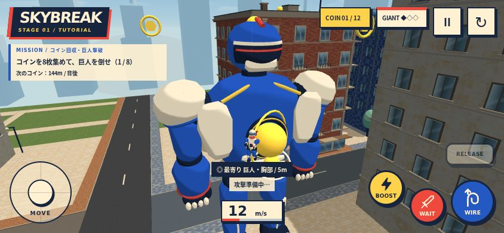
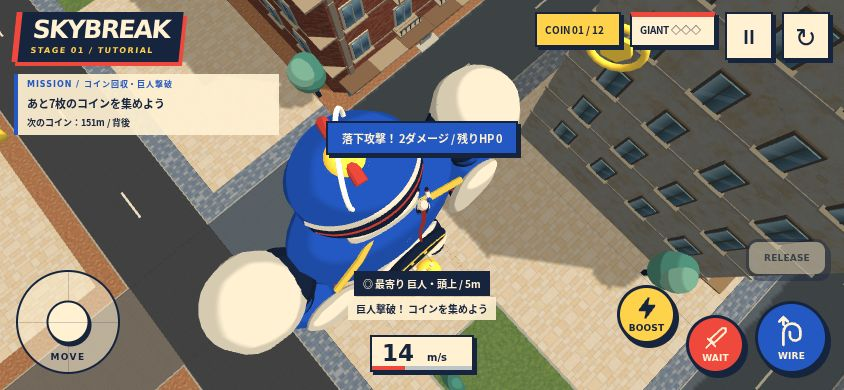

# 高速突進・落下攻撃

ATTACKボタンを共通で使い、発動可能な時はRUSHまたはDIVEに表示を変えます。Eキーも同じ処理です。通常攻撃は残しています。

| 種類 | 発動条件 | 動作 | ダメージ |
| --- | --- | --- | --- |
| 通常攻撃 | 弱点から22m以内、建物で遮られていない | 従来の近接攻撃 | 1 |
| 高速突進 / RUSH | 空中で22m/s以上、弱点へ向かう速度成分がある、画面内の弱点から40m以内 | ワイヤーを解除し弱点へ突進 | 2 |
| 落下攻撃 / DIVE | 空中で弱点より8m以上高く、6m/s以上で落下、水平距離24m以内・直線距離40m以内 | ワイヤーを解除して弱点へ急降下 | 2 |

特殊攻撃は画面内かつカメラ・キャラ双方から建物に遮られない弱点だけを狙います。落下攻撃を優先して選び、条件を満たさなければ高速突進、さらに条件を満たさなければ通常攻撃です。上昇中や巨人から離れる飛行だけでは特殊攻撃になりません。

発動時に位置は変えず、速度を弱点方向へ向けます。最長1.4秒、通常の重力と建物衝突を使って実際に移動し、弱点の4.8m以内へ到達した時に一度だけダメージが入ります。移動区間全体で接触を判定して高速時のすり抜けを防ぎます。壁・屋上への接触、時間切れ、新しいWIRE接続、リトライ・リスポーンで終了。発動時から1.75秒のクールダウンがあり、ポーズ中は移動も攻撃時間も進みません。

命中後は上向き12m/sと弱点から離れる反動を与え、ワイヤーを再接続して飛行へ戻れます。既存の12個のエフェクトプールと弱点の点滅を使い、攻撃ごとにメッシュを増やしません。巨人HPは従来通り3で、特殊攻撃1回では満タンから倒せません。HUDと遊び方に操作を追加しました。頭上から弱点を画面に入れやすくするため、手動カメラの下向き範囲を約75度まで広げています。

## 検証

verify:gameplayにRUSH/DIVEの選択、上昇中・逆向き・地上・画面外・距離超過の除外、30/60/120Hzでの実際の移動と命中、すり抜け防止、空振り、反動、ダメージとクールダウンを追加しました。

844×390のタッチエミュレーションで、タイトルからステージ1を開始し、実際の前進・WIRE/NEXT/BOOST入力で3ポイントを通過。巨人へ飛行してATTACKを押し、高速突進の発動直後はHP3のまま、移動して命中後はHP1になることを確認しました。攻撃中にポーズしても残り時間が変わらないことも確認。その後、上向きカメラとBOOSTで上昇し、下向きカメラで弱点を画面に入れて落下中にATTACK。落下攻撃の命中でHP1→0、上向きの反動を確認しました。位置・速度・HPを直接変更せず、ゲーム本体の入力と更新処理を使用しています。コンソールエラーなし。スマホ実機の操作感・FPS・発熱は未確認です。

