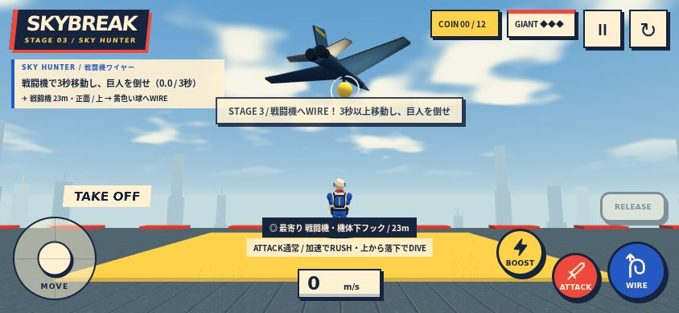
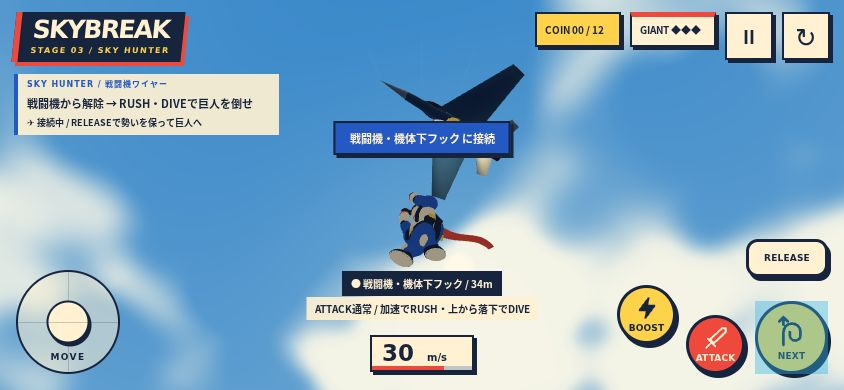
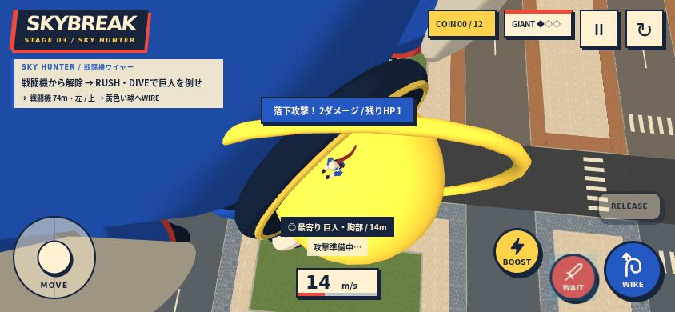
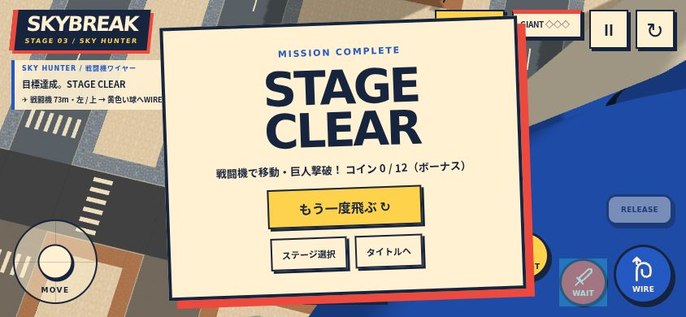

# Stage 3 — 天空の狩人 / SKY HUNTER

ステージ2の高層街・段状ビル・連絡橋・給水塔・巡回する巨人を使い、ワイヤーで接続できる戦闘機を1機追加。

## 遊び方

1. ステージ選択の「03 天空の狩人」から開始。開始直後、前方の戦闘機の黄色いフックへWIRE。
2. 機体につかまって3秒以上移動する。接続時間は累計。地面や建物への接触で接続が解除される。
3. 巨人の近くでRELEASE。勢いを維持して飛び出し、巨人を見ながらATTACK。条件を満たすとRUSHまたはDIVEになり、実際の接触で2ダメージ。
4. 巨人撃破と戦闘機での移動3秒でクリア。コイン12枚は任意のボーナス。クリア記録はステージ1・2と別に保存。

NEXTで機体から別の可視ポイントへ、別のポイントから機体へも乗り換え可能。選択規則は画面内の最寄りの接続可能ポイントで共通。特別な機体優先選択は行わない。

## 実装

- 52秒の閉じたCatmull–Rom周回。開始地点付近では約9m/s、街と巨人の上空へ向かい、外周を回って帰る。位置・速度はループ境界で連続。旋回に合わせたバンクは平滑化。
- 飛行高度は約133–141m。機体の大きさを含め、120mの開始屋上と既存街区を避ける。
- 接続時にプレイヤーの位置や機体速度をコピーしない。通常の接続時に約3mのたるみを加え、張った後は減衰付きの弾性ワイヤーで引く。張力による加速度は最大32m/s²。成人の重さを感じる重力・振れを残す。
- 地面からの再接続では既存の巻き取りを使うため、追加のたるみは設けない。巻き取り速度を張力の計算へ反映し、離陸が途中で失速しないようにする。
- RELEASEと空中NEXTは現在の運動量を維持。街・屋上との衝突、通常攻撃、高速突進、落下攻撃は共通の処理。
- コミック調の機体はコードで作成。胴体・後退翼・コックピット・尾翼・排気口・黄色の識別帯。4材質に結合し、追加の画像素材や動的シャドウは使わない。
- HUDに機体までの距離・方向・上下を表示。接近時の合成エンジン音は音量設定・ミュート・一時停止に従う。機体からの射撃はない。

## 確認

- `npm run build`、`verify:city`、`verify:flight`、`verify:gameplay`：成功。
- 追加テスト：周回の位置/速度連続性、速度・加速度・バンク、屋上クリアランス、クリア条件、たるみ中の無加速、急激な速度変更の防止、牽引、解除時の運動量、30/60/120Hz安定性、地面からの巻き取り復帰。
- 844×390のタッチ環境のPlaywrightで、ステージ選択→機体への接続→3.2秒の移動→解除→DIVE接触（HP3→1）→通常攻撃（HP1→0）→コイン0枚でクリア→記録保存→リトライを実操作で確認。位置・速度・HPの書き換えは行わない。
- 機体→巨人の頭上→機体へのNEXT乗り換え、一時停止時の機体と累計時間の停止、リトライ時の初期位置・時間リセットも確認。
- 素材を遅延させた公開リンク相当の自動開始でも、読み込み完了までは機体・巨人・プレイヤーの時間を進めず、最初の接続機会を維持することを確認。
- ステージ2の動く巨人への接続・攻撃、ステージ1への切替とチュートリアル完走も確認。ブラウザコンソールエラーなし。
- 確認場面の総頂点数は約853,194。機体追加分は約826頂点、4材質＋フック1メッシュ。描画回数はカメラ次第で変わるため異なる視点間では比較しない。スマホ実機のFPS・発熱は未計測。

以下は実際の操作中の画面。外部からプレイヤーやカメラの座標を書き換えた確認用レンダーではない。

