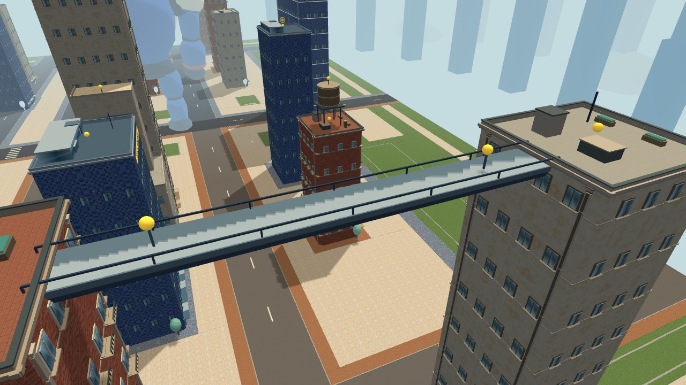
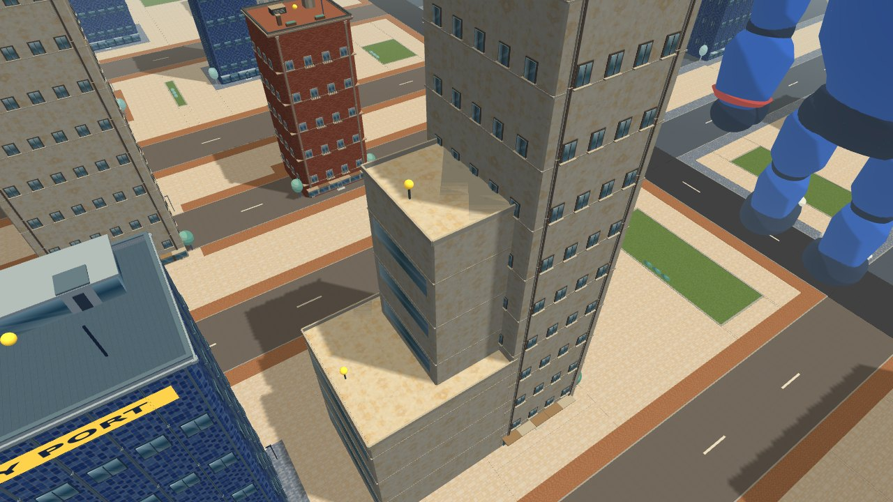
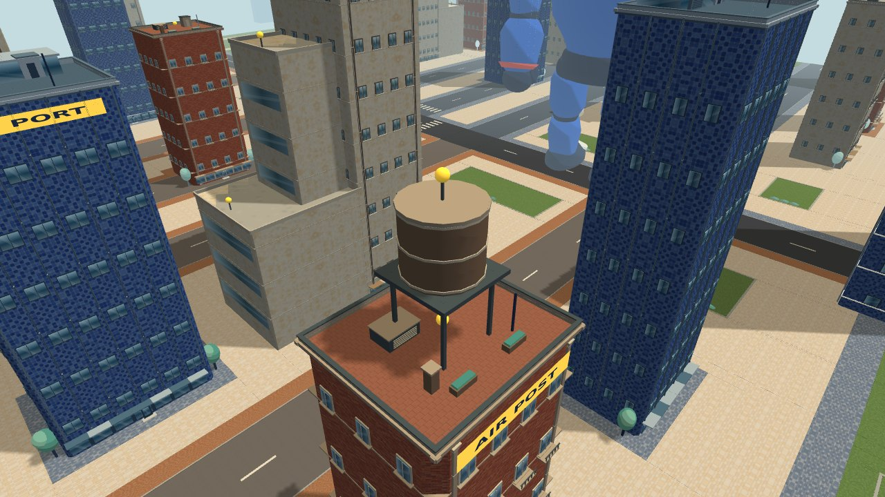

# Stage 2 rooftop structures

Adds two rooftop bridges, two stepped towers (four terrace wings), and two water towers. Existing tower heights, player size and the giant patrol stay unchanged.

- Bridges: west/east outer row, x=±210, z=-136…-88, roof 72m. Both ends overlap existing roofs. Each bridge has two usable hooks at 74.2m. The deck and underside beams have elevated collision bounds, leaving the street and air beneath open.
- Stepped towers: cream plaster wings beside existing 81m/84m towers. West terraces at 27m and 54m; east at 28m and 56m. Each exposed terrace has a wire hook; terrace roofs support landing and ground recovery reeling. Their ground footprints are reserved by the street/landscape planner.
- Water towers: brick roofs at (-124,-144) and (140,76), with metal legs, service deck, cylindrical tank and flat lid. Roof heights 42m/54m; top hooks 57.1m/69.1m. Legs collide individually so the entire space below the tank is not treated as a solid box.
- All 10 yellow markers are real wire targets and participate in the existing nearest-visible selection and NEXT transfer rules.
- Shared existing wall/roof/trim/glass materials; static geometry merged by material. No additional texture assets or per-frame structure animation.

## Verification

`verify:flight`, `verify:gameplay`, `verify:city`, and production build pass. Added tests cover bridge underflight, upward underside contact, deck landing, side contact, supported bridge ends, tower roof fit and >36m giant-patrol clearance.

Playwright in 844×390 touch mode confirms stage 2 load, pause/reset, moving giant wire connection, contact-based special attack, and stage 1 tutorial completion after switching. No browser console errors. Ten structure hooks are present. Representative stage 2 gameplay: 164 draw calls and 852,368 total vertices (about 5,070 extra vertices). Actual phone FPS and temperature are unmeasured.

The images below are real scene renders using inspection camera positions with the interface hidden, rather than player screenshots or generated concept art.

