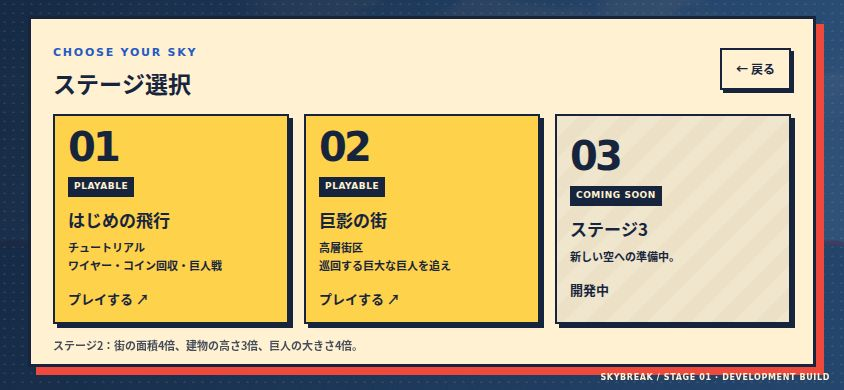
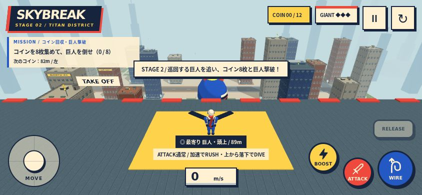
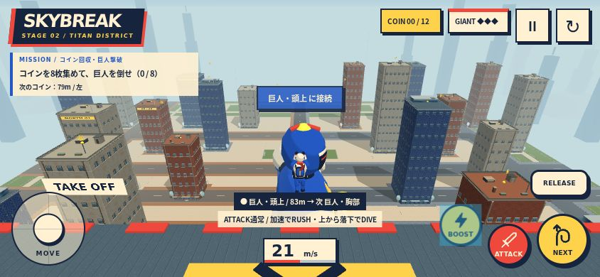
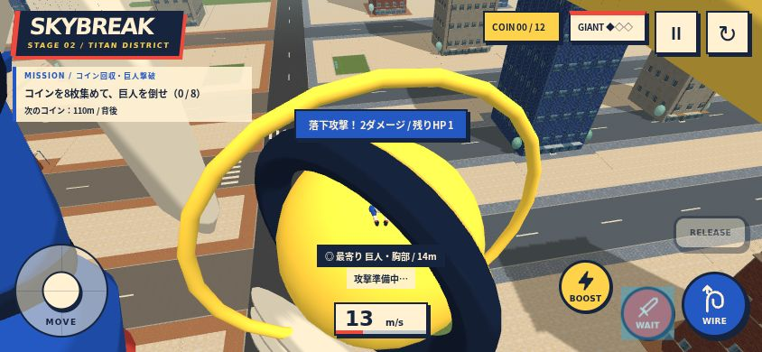

# ステージ2「巨影の街」

| 対象 | ステージ1 | ステージ2 |
| --- | --- | --- |
| 街の面積 | 240×240m | 480×480m（4倍） |
| 移動制限の範囲 | ±116m | ±232m（面積4倍） |
| 元の20棟の高さ | 13〜28m | 39〜84m（各棟ちょうど3倍） |
| 開始ビル | 40m | 120m |
| 巨人 | 1倍 | モデルを均等に4倍（頭上フック92m・胸弱点56m） |
| 主人公 | 1倍 | 1倍 |
| 建物配置 | 20棟＋開始ビル | 28棟＋開始ビル、中央に巡回帯 |

外壁3種・道路3種・歩道3種・庭や公園の素材は共通。20棟の元の平面座標を2倍にし、幅・奥行きは維持。外周に高さ72mの8棟を追加しています。屋上の設備・窓・面取り柱は同じデザインのまま、高層ビルの窓と柱の細かな分割を間引き、静的形状を材質別にまとめています。道路は平面方向に2倍の範囲と幅を持ち、アスファルトのUVは実際のメートル座標を使用。ベンチや主人公の寸法は拡大しません。空・霧・遠景・影の表示範囲も拡張しています。

## 巨人と遊び方

中央の広い帯を楕円状に巡回します。周期は約126秒、速度は最大約4.5m/s。建物から36m以上の余白を確保した経路を検証しています。進む方向を向き、足と腕を交互に動かします。ポーズ中・タイトル中・撃破後は巡回を停止し、やり直しで開始位置へ戻ります。

巨人の左肩・右肩・胸部・頭上のポイントと胸の弱点は、巨人の移動・向き・4倍スケールから毎物理ステップで位置を更新します。接続中は移動する支点の速度を考慮し、ワイヤーを保ったまま追従。特殊攻撃は移動する弱点との相対的な移動区間で命中を判定します。ステージ1の静止巨人とチュートリアルは維持します。

ステージ2はコイン12枚のうち8枚を集めて巨人を倒すとクリア。HP・攻撃ダメージはステージ1と同じです。3ポイントの練習区間は付けず、120mの屋上からすぐに巡回する巨人へ飛び出せます。ステージ選択・リトライ・続行・CLEAR保存は各ステージに対応します。ステージの切り替え時は旧シーンを残さないよう、同じページのstageパラメータで街を読み直します。

## 検証

verify:gameplayで寸法比、元の建物の高さ3倍、巡回経路の建物からの距離、速度・向き、追従フックと屋上コインの配置を確認。verify:city / verify:flightと本番ビルドも確認しています。

844×390のタッチエミュレーションでステージ選択→2開始、主人公1倍・巨人4倍、120mの開始屋上、ポーズ中の巨人位置・時計の固定、移動する頭上ポイントへの接続を確認。実際の前進・BOOST・WIRE入力で接近し、移動中の弱点へDIVEで命中してHP3→1を確認しました。リトライで巨人時計0と開始位置へ戻り、タイトルからステージ1へ切り替わり、1→2→3の練習区間を完了できることも確認。位置・速度・HPを直接変更せずゲーム本体の入力・更新を使用しています。

確認場面は約147描画、総頂点数約84.7万。細部を間引く前の約97.4万から減らしています。スマホ実機のFPS・発熱は未確認です。

## 次の構造物案（未実装）

- 屋上連絡橋：横へ移る飛行ルートと、中継フックを作れる。巨人の巡回帯には架けず、左右の街区内に配置する。
- 段状の高層ビル：中層の着地場所と再加速の足場を作り、巨人の肩と頭の高度へ段階的に上がれる。
- 屋上給水塔：色と輪郭で遠くから分かるランドマークにし、上部を追加のワイヤーポイントにできる。
