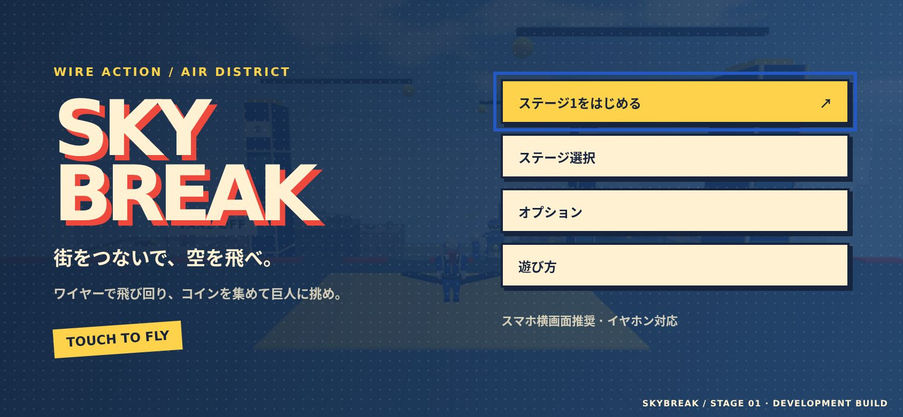
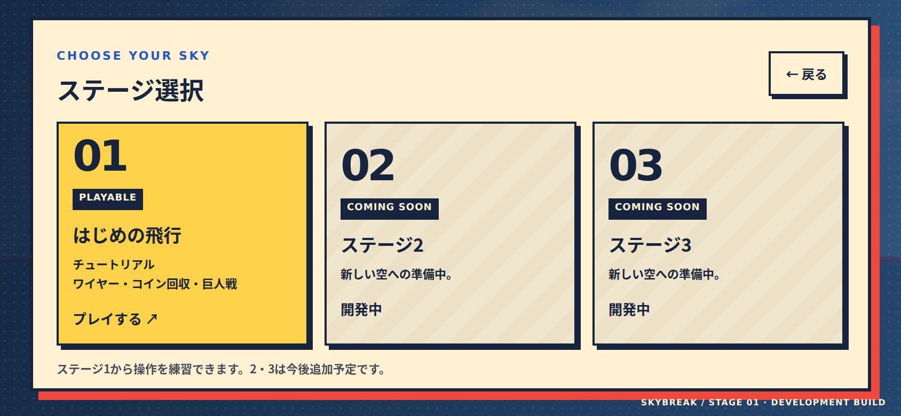
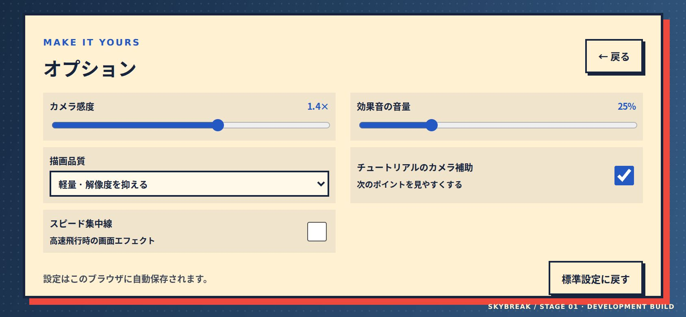
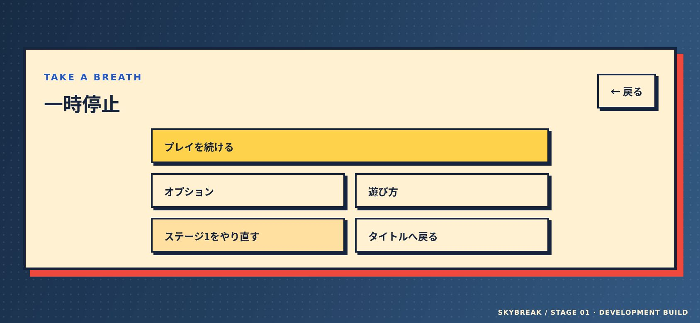

# タイトル・ステージメニュー

## 画面

- タイトル：ステージ1開始、ステージ選択、オプション、遊び方。プレイを中断して戻った場合は「プレイを続ける」も表示。
- ステージ選択：1は「はじめの飛行 / チュートリアル」。既存の街、3ポイント、コイン8枚と巨人撃破の目標を維持。2は「巨影の街」としてプレイ可能。3は開発中の案内画面を用意し、ゲームを開始しない。
- 一時停止：同じ位置から再開、設定、操作説明、確認付きやり直し、タイトル復帰。バックグラウンド移行・フォーカス喪失でも自動停止。
- クリア：リプレイに加えてステージ選択とタイトルへのリンク。クリア状態を保存し、選択画面にCLEARを表示。

メニュー表示中は物理・ゲームの進行を止めます。背景の3D描画は毎秒最大4回に抑えます。操作入力は切り替え時にリセットし、押しっぱなしの移動が残らないようにしています。ポーズでブーストの時間・クールダウンを進めたりリセットしたりしません。

## 設定

| 項目 | 内容 |
| --- | --- |
| カメラ感度 | 0.5〜2.0倍。右側スワイプとマウスドラッグに適用 |
| 描画品質 | 軽量1倍 / 標準1.5倍 / 高画質2倍を上限に描画解像度を調整 |
| 効果音 | 0〜100%。UI・接続・ブースト・コイン・攻撃の短い合成音 |
| カメラ補助 | チュートリアルで次のポイントを先読みする補正のON/OFF |
| 集中線 | 高速飛行時の画面エフェクトのON/OFF |

設定と各ステージのクリア状態はlocalStorageへ保存します。読み込み値を検証し、保存が使えない場合もそのセッションの設定変更は動作します。途中の位置・進捗はページ再読み込みでは保存しません。ブラウザのデータを消すと設定・クリア状態も消えます。

## 確認

本番ビルドとverify:city / verify:flight / verify:gameplayを確認。844×390のタッチエミュレーションでタイトル、2・3の開発中案内、オプションの変更・保存・標準設定復帰、ステージ1開始、ポーズ中の位置・速度固定、再開、やり直しのキャンセルと実行、タイトルからの続行、EscとSpaceを確認。描画品質の軽量設定で幅844pxになること、設定が再読み込み後も維持されること、390×844の縦画面で横にはみ出さないことを検証しました。

タイトルから開始したゲーム本体でポイント1→2→3の通過と3/3まで確認。クリア画面のポーズ復帰とCLEAR保存・表示はメニュー単体のコールバックを使う境界テストで確認しました。コンソールエラーなし。スマホ実機の操作感・FPS・発熱は未確認です。

ステージ2の追加に合わせ、ステージ間の移動では街を読み直す構成になりました。設定は引き継ぎ、進行中のプレイを切り替える時は確認画面を表示します。ステージごとに独立したCLEARを保存します。
